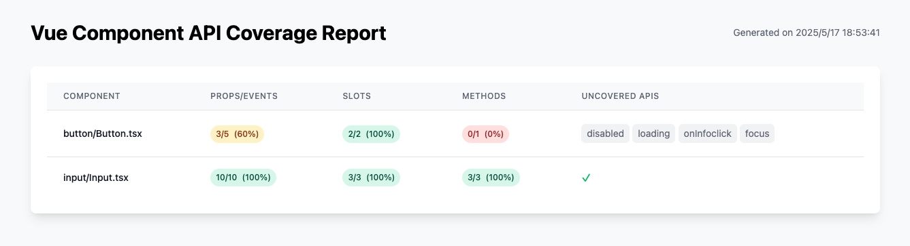

# vc-api-coverage
A Vue Component API Coverage Tool.

A specialized Vitest reporter designed for Vue 3 TSX components that helps you track and improve your component API coverage. This tool analyzes and reports the usage coverage of your component's Props, Events, Slots, and Exposed methods in your tests.

[![NPM version][npm-image]][npm-url]
[![build status][ci-image]][ci-url]
[![Test coverage][coveralls-image]][coveralls-url]
[![npm download][download-image]][download-url]

[npm-image]: http://img.shields.io/npm/v/vc-api-coverage.svg?style=flat-square
[npm-url]: http://npmjs.org/package/vc-api-coverage
[ci-image]: https://github.com/rudyxu1102/vc-api-coverage/workflows/CI/badge.svg
[ci-url]: https://github.com/rudyxu1102/vc-api-coverage/actions
[coveralls-image]: https://img.shields.io/coveralls/rudyxu1102/vc-api-coverage.svg?style=flat-square
[coveralls-url]: https://coveralls.io/r/rudyxu1102/vc-api-coverage?branch=main
[download-image]: https://img.shields.io/npm/dm/vc-api-coverage.svg?style=flat-square
[download-url]: https://npmjs.org/package/vc-api-coverage

## Features

- 📊 Detailed coverage reporting for Vue 3 TSX components
- ✨ Tracks Props, Events, Slots, and Methods Coverage
- 🎯 Visual representation of test coverage with emoji indicators
- 🔍 Clear identification of untested component APIs
- 📈 Coverage percentage calculation for each API category
- 🔬 **Strict Mode**: Granular tracking of union type variants (e.g., checks each value of `'primary' | 'secondary' | 'tertiary'` separately)

## Installation

```bash
npm install vc-api-coverage --save-dev
# or
yarn add -D vc-api-coverage
# or
pnpm add -D vc-api-coverage
```

## Usage

1. Add the reporter to your Vitest configuration:

```ts
// vitest.config.ts
import { defineConfig } from 'vitest/config'

export default defineConfig({
  test: {
    reporters: ['vc-api-coverage']
  }
})
```

2. Run your tests as usual:

```bash
vitest
```

The reporter will automatically generate coverage reports for your Vue 3 TSX components, showing which APIs are covered by your tests and which ones need attention.

## Configuration

The reporter supports several configuration options to customize its behavior:

```ts
// vitest.config.ts
import { defineConfig } from 'vitest/config'

export default defineConfig({
  test: {
    reporters: [['vc-api-coverage', {

      // Output directory for the coverage report
      outputDir: 'coverage-api',

      // Report formats: 'cli', 'html', 'json'
      // You can specify multiple formats: ['cli', 'html']
      format: ['cli', 'html', 'json'],

      // Whether to open browser after generating HTML report
      openBrowser: false,

      // Include patterns: only analyze files matching these glob patterns
      // Can be a single string or an array of strings
      include: ['**/src/components/**/*.{tsx,vue}'],

      // Exclude patterns: skip files matching these glob patterns
      // Can be a single string or an array of strings
      exclude: ['**/*.vue'],

      // Strict mode: check each variant of union type props individually
      // When enabled, props like 'variant: "primary" | "secondary" | "tertiary"'
      // are tracked as 3 separate APIs instead of 1
      // See docs/strict-mode.md for details
      strict: false,

      // Callback function executed when coverage report is completed
      // Receives coverage data array where each item contains component coverage details
      // Can be used for custom processing, CI integration, or enforcing coverage thresholds
      onFinished: (data) => {
        for (const item of data) {
          if (item.total > item.covered) {
            throw new Error(`${item.name} API Coverage is not 100%`)
          }
        }
      }
    }]]
  }
})
```

## How It Works

This tool analyzes your Vue 3 TSX components by leveraging TypeScript's type system and AST analysis:

- **Props/Events**: Extracted via `InstanceType<typeof Component>['$props']`
- **Slots**: Extracted via `InstanceType<typeof Component>['$slots']`
- **Exposed Methods**: Identified through AST analysis of `defineExpose()`

For detailed implementation information, see [Implementation Details](./docs/implementation.md).

## Example Output

### 1. CLI Format
```
╔═══════════════════╤══════════════╤═══════╤═════════╤═════════════════════════════════╗
║ Components        │ Props/Events │ Slots │ Exposes │ Uncovered APIs                  ║
╟───────────────────┼──────────────┼───────┼─────────┼─────────────────────────────────╢
║ All               │          87% │  100% │     75% │                                 ║
╟───────────────────┼──────────────┼───────┼─────────┼─────────────────────────────────╢
║ button/Button.tsx │          3/5 │   2/2 │     0/1 │ disabled, loading, onInfoclick  ║
╟───────────────────┼──────────────┼───────┼─────────┼─────────────────────────────────╢
║ input/Input.tsx   │        10/10 │   3/3 │     3/3 │ ✔                               ║
╚═══════════════════╧══════════════╧═══════╧═════════╧═════════════════════════════════╝
```

### 2. HTML Format



### 3. JSON Format
```json
{
  "summary": {
    "totalComponents": 1,
    "totalProps": 10,
    "coveredProps": 8,
    "totalSlots": 5,
    "coveredSlots": 5,
    "totalExposes": 4,
    "coveredExposes": 0
  },
  "stats": {
    "props": 80,
    "slots": 100,
    "methods": 0,
    "total": 72
  },
  "components": [
    {
      "name": "Button.tsx",
      "file": "src/components/button/Button.tsx",
      "props": {
        "total": 4,
        "covered": 2,
        "details": [
          {
            "name": "loading",
            "covered": false
          },
        ]
      },
      "slots": {
        "total": 2,
        "covered": 2,
        "details": [
          {
            "name": "default",
            "covered": true
          },
        ]
      },
      "exposes": {
        "total": 1,
        "covered": 0,
        "details": [
          {
            "name": "focus",
            "covered": false
          }
        ]
      }
    },
  ]
}
```

## Strict Mode

Strict mode enables more granular API coverage tracking by expanding union types and checking each variant individually.

### Why Use Strict Mode?

In normal mode, the tool only checks if a prop is tested at all. In strict mode, it ensures that each possible value of a union type prop is tested, helping you achieve more thorough test coverage.

### Example

```typescript
// Component definition
const buttonProps = {
  variant: {
    type: String as PropType<'primary' | 'secondary' | 'tertiary'>,
    default: 'primary'
  },
  disabled: { type: Boolean, default: false }
}
```

**Normal Mode** - Checks if prop is tested with any value:
```
║ button/Button.tsx │ 2/2 │ Uncovered APIs: (none)
```

**Strict Mode** - Checks if each variant is tested:
```
║ button/Button.tsx │ 3/4 │ Uncovered APIs: variant[tertiary]
```

### Enabling Strict Mode

```typescript
// vitest.config.ts
export default defineConfig({
  test: {
    reporters: [['vc-api-coverage', {
      strict: true  // Enable strict mode
    }]]
  }
})
```

### Variant Expansion Rules

| Type | Expansion Behavior | Example |
|------|-------------------|---------|
| Literal Union | Each value tracked separately | `'a' \| 'b' \| 'c'` → `[a]`, `[b]`, `[c]` |
| Boolean | Only `true` tracked (false filtered) | `boolean` → `[true]` |
| Primitive Union | Each type tracked | `string \| number` → `[string]`, `[number]` |
| Optional Props | `undefined` filtered out | `T \| undefined` → `T` only |

### Example Output with Strict Mode

```
╔═══════════════════╤═══════════════╤═══════╤═════════╤════════════════════════════════╗
║ Components        │  Props/Events │ Slots │ Exposes │ Uncovered APIs                 ║
╟───────────────────┼───────────────┼───────┼─────────┼────────────────────────────────╢
║ button/Button.tsx │          5/10 │   0/2 │     0/1 │ variant[tertiary],             ║
║                   │               │       │         │ loading[true],                 ║
║                   │               │       │         │ size, onInfoclick,             ║
║                   │               │       │         │ default, icon, focus           ║
╚═══════════════════╧═══════════════╧═══════╧═════════╧════════════════════════════════╝
```

Notice how `variant[tertiary]` and `loading[true]` are tracked as individual variants.

For complete documentation, see [Strict Mode Documentation](./docs/strict-mode.md).

## Contributing

Contributions are welcome! Please feel free to submit a Pull Request.

## License

MIT
